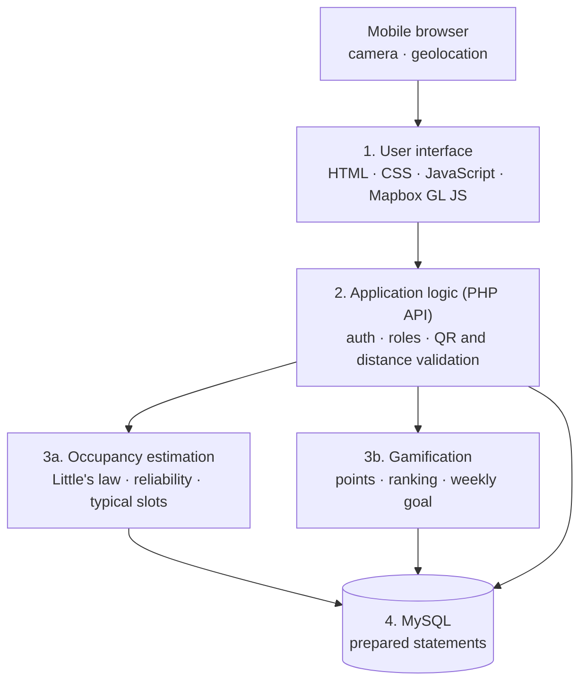
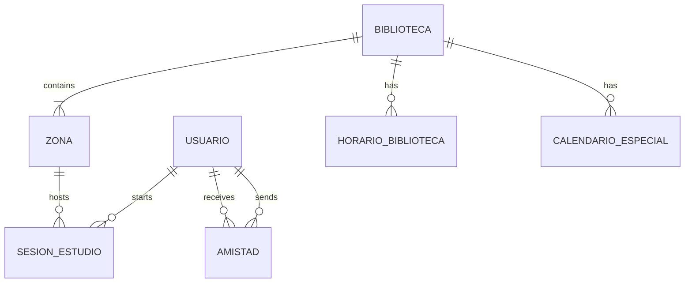

<div align="center">


**Know how busy the library is before you leave home — and see where your friends are studying.**

*QR check-in · real-time occupancy estimate · friends · points*


</div>

---

> **Finding a free desk shouldn't depend on luck.** During exam weeks, students face overcrowded libraries, wasted trips and lost time, and coordinating with friends to sit together relies on scattered chat messages. StudySpot turns the search for a desk into a fast, collaborative and transparent process.

## The problem

Existing tools solve only a part of it. This comparison comes from the state of the art we analysed in Sprint 0, based on their public documentation:

| Product | What it does well | Limitation |
|---|---|---|
| **Waitz** | Floor-level occupancy before you leave home, no personal data collected | Modelled estimates, large areas only, needs hardware installed by the institution |
| **Affluences** | Occupancy updated every 60 seconds, seat reservations | Needs hardware and advance booking with QR confirmation |
| **StudyRank** | Friends' presence and weekly leaderboard | Does not know whether you are at the library or how crowded it is |
| **StudySpot** | Occupancy + friends + progress from a single piece of data | *Our goal* |

None of them combine **occupancy** and **social study**, and occupancy products depend on infrastructure the student does not control.

## The idea

A **single voluntary check-in** feeds three things at once: the library's real-time occupancy, your friends' presence and your own progress. No sensors and no installation by the institution.

1. The student scans the **QR code** of a library zone with the phone camera.
2. The server validates the token and, if the phone is close to the library, starts a **study session**.
3. When the student checks out (or the session expires), the session ends and **points** are awarded.
4. Everyone can see **how full each library is**, at what times it is usually quiet and which friends are studying.

### How occupancy is estimated

Based on **Little's law** (L = λW): the average number of people in a space equals the arrival rate times the average length of stay. StudySpot counts active sessions, divides them by an **adoption factor** (the fraction of students who use the app, calibrated with manual head counts) and shows the result as a percentage of capacity. Because it is an estimate, the app shows a **reliability indicator** based on the number of active users.

## Features

| | Feature | Priority |
|---|---|---|
| US01 | Register with the institutional email | Must |
| US02 | QR check-in (near the library) and check-out / automatic expiry | Must |
| US03 | Map to pick a library and see its occupancy with a reliability indicator | Must |
| US04 | Points for every study session | Must |
| US05 | Typical busy and quiet time slots by day and hour | Should |
| US06 | Friend requests and friends' location, only if they choose to share it | Should |
| US07 | Weekly ranking among friends and shared weekly goal | Could |
| US08 | Library opening hours and special calendar (exams, Christmas) | Could |

### Privacy by design

- Location sharing with friends is **voluntary and off by default**, and only between friends who have accepted the request.
- The phone's coordinates are used **only to validate the check-in and are not stored**.
- Passwords are stored hashed and all database queries use prepared statements.

## Architecture

A simple client-server **layered monolith**, chosen because it is realistic for a one-semester project.



### Data model



## Tech stack

| Layer | Technology |
|---|---|
| Frontend | HTML, CSS, JavaScript, Mapbox GL JS |
| Backend | PHP on Apache |
| Database | MySQL |
| Platform | Web app for mobile browsers (no installation) |
| Collaboration | GitHub (Issues and Projects) |

## Planned project structure

```
studyspot/
├── public/            User interface (HTML, CSS, JavaScript, Mapbox map)
│   ├── index.html
│   ├── css/
│   ├── js/
│   └── img/
├── api/               PHP endpoints (register, login, check-in, check-out, occupancy...)
├── src/               Application logic
│   ├── Ocupacion/     Occupancy estimation module
│   ├── Gamificacion/  Points, weekly ranking and weekly goal module
│   └── Database/      MySQL connection (PDO, prepared statements)
├── database/
│   └── schema.sql     Table creation script
├── docs/              Sprint documents, diagrams and wireframes
└── README.md
```

This structure is the planned one and may change during Sprint 2.

## Getting started

### Requirements

- [XAMPP](https://www.apachefriends.org/) (Apache, PHP and MySQL)
- [Git](https://git-scm.com/)
- A [Mapbox](https://www.mapbox.com/) access token (free account)

### Running the project locally (work in progress)

The code is not implemented yet. These are the planned steps and they will be completed in Sprint 2.

1. Clone this repository inside the `htdocs` folder of XAMPP:
```
   git clone https://github.com/930089Luu/StudySpot studyspot
```
2. Start **Apache** and **MySQL** from the XAMPP control panel.
3. Create a MySQL database called `studyspot` (for example from phpMyAdmin at `http://localhost/phpmyadmin`).
4. Import `database/schema.sql` into that database (the file will be added in Sprint 2).
5. Add your Mapbox token and the database credentials to the configuration file (to be defined in Sprint 2).
6. Open `http://localhost/studyspot/public/` in your browser.

## Roadmap

| Sprint | Focus | Status |
|---|---|---|
| Sprint 0 | Discovery and proposal: state of the art and project idea | Done |
| Sprint 1 | Analysis and planning: User Stories, models, architecture | In progress |
| Sprint 2 | Coding and testing | Planned |
| Sprint 3 | Deployment and user testing | Planned |

## Team

| | |
|---|---|
| **Lucía Claver Bolea** | Developer |
| **Miguel Salado Serrano** | Developer |

Project for the course **Programming Lab [22356]** · ISLA Gaia · 2026/2027. The Scrum Master role rotates between the two team members.
